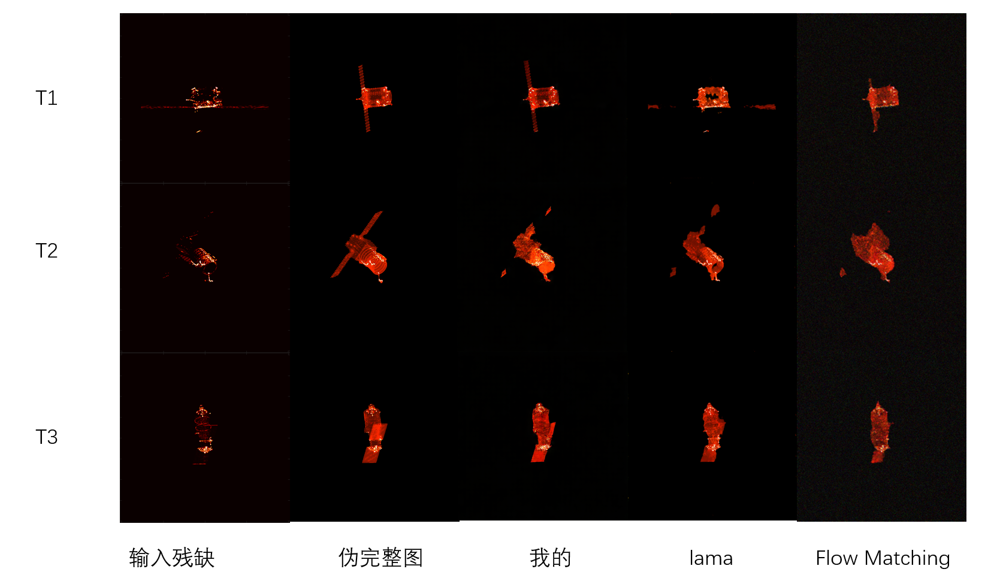
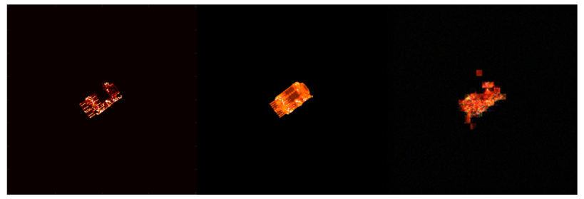

# 周报

| **方法**                                      | **MAE ↓**  | **MSE ↓**  | **PSNR ↑ (dB)** |
| --------------------------------------------- | ---------- | ---------- | --------------- |
| ControlNet                                    | 0.23       | 0.07       | 11.5            |
| RAD                                           | 0.0064     | 0.0026     | 25.69           |
| LaMa（调整后不使用mask进行训练推理）          | **0.0045** | **0.0016** | **27.83**       |
| MI-GAN                                        | 0.0166     | 0.0021     | 26.73           |
| DeltaFM（指标挺好但是图片很差）               | 0.0164     | 0.0037     | 24.30           |
| Flow Matching（调整后不使用mask进行训练推理） | 0.0451     | 0.0036     | 24.35           |
| 我的（调整了一下参数）                        | 0.0066     | 0.0019     | 27.05           |

最右侧是DeltaFM的推理结果，还需要再改一下。

