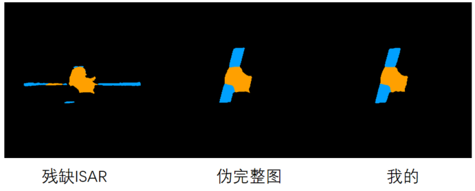
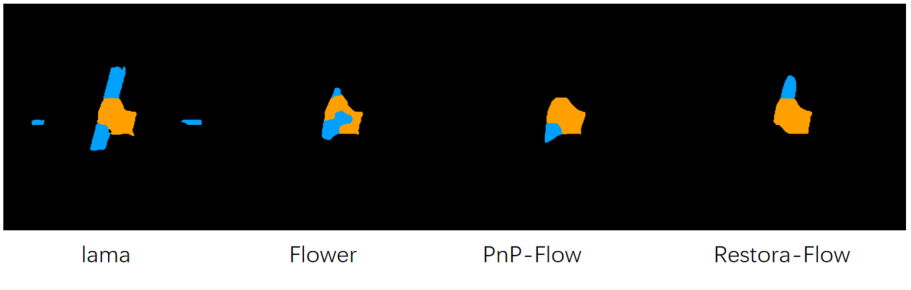

# 周报

## 分割指标

利用unet分割，其中部件分割包括舱体和帆板。前景二分类分割利用舱体和帆板拼接得到。

| 任务   | 方法         |    N |   Dice | 前景/部件 IoU |   mIoU | 参照来源                                       |
| ------ | ------------ | ---: | -----: | ------------: | -----: | ---------------------------------------------- |
| binary | 残缺ISAR原图 |  409 | 0.7036 |        0.5428 | 0.7625 | 生成伪完整图时，利用像素信息得到的完整轮廓mask |
| binary | 伪完整图     |  409 | 0.9789 |        0.9586 | 0.9785 |                                                |
| binary | cjh_sd       |  409 | 0.9539 |        0.9118 | 0.9541 |                                                |
| binary | Flower       |  409 | 0.8351 |        0.7169 | 0.8532 |                                                |
| binary | lama         |  409 | 0.9062 |        0.8285 | 0.9108 |                                                |
| binary | PnP-Flow     |  409 | 0.7370 |        0.5836 | 0.7840 |                                                |
| binary | Restora-Flow |  409 | 0.7386 |        0.5855 | 0.7851 |                                                |
| parts  | 残缺ISAR原图 |  409 | 0.5658 |        0.4073 | 0.5990 | 分割模型推理伪完整图得到的mask                 |
| parts  | 伪完整图     |  409 | 1.0000 |        1.0000 | 1.0000 |                                                |
| parts  | cjh_sd       |  409 | 0.9162 |        0.8458 | 0.8962 |                                                |
| parts  | Flower       |  409 | 0.6292 |        0.4794 | 0.6491 |                                                |
| parts  | lama         |  409 | 0.8266 |        0.7078 | 0.8031 |                                                |
| parts  | PnP-Flow     |  409 | 0.4787 |        0.3767 | 0.5790 |                                                |
| parts  | Restora-Flow |  409 | 0.5073 |        0.3928 | 0.5897 |                                                |

SSIM 差异，消融实验还没做，下周做一下。关键点检测也可以做一下。
