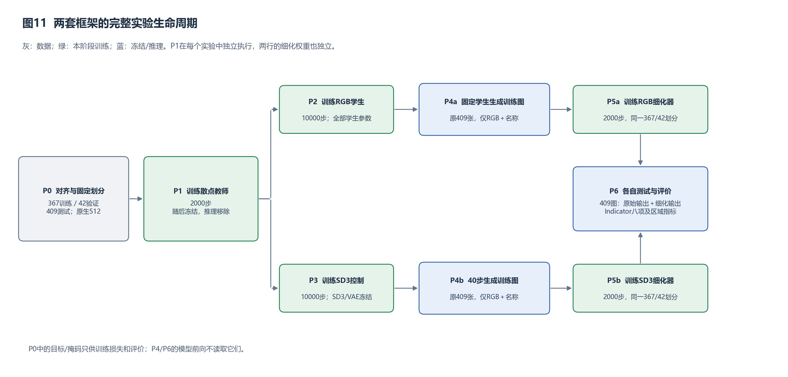
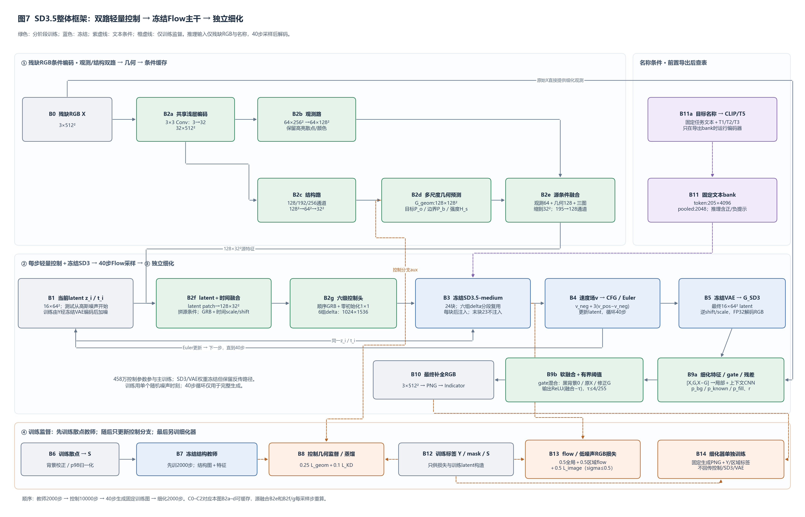
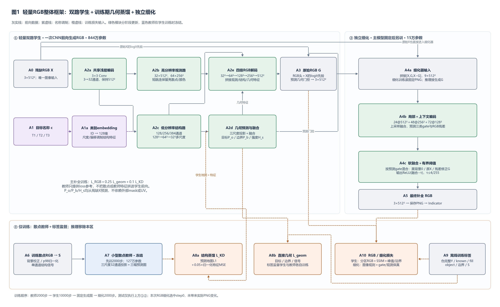
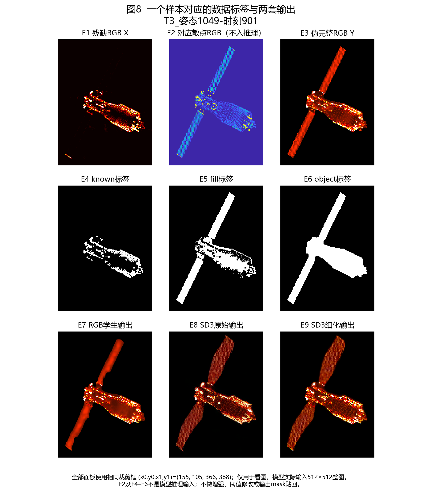

# 周报

把之前的大参数的方法框架删除了很多不相干的部分，现在保留了两套框架。一套预训练SD3.5-medium，batch_size设为1训练十几个小时。一套用一次CNN前向生成补全图，batch_size设为1训练十小时以内。训练参数还没有去统计，应该都不会很大了。

| 方法           |        MAE ↓ |        MSE ↓ |         L2 ↓ | PSNR ↑（dB） |       SSIM ↑ |      DSSIM ↓ |      LPIPS ↓ |     FID ↓ |
| :------------- | -----------: | -----------: | -----------: | -----------: | -----------: | -----------: | -----------: | --------: |
| Flower         |     0.005995 |     0.002070 |     0.001035 |        26.84 |     0.955866 |     0.022067 |     0.064552 |    139.86 |
| Restora-Flow   |     0.005233 |     0.002717 |     0.001358 |        25.66 |     0.977156 |     0.011422 |     0.068363 |    158.14 |
| PnP-Flow       |     0.006851 |     0.002730 |     0.001365 |        25.64 |     0.933340 |     0.033330 |     0.078402 |    135.54 |
| LaMa           |     0.004539 |     0.001647 |     0.000824 |        27.83 |     0.975298 |     0.012351 |     0.055899 |     95.28 |
| 我的（大参数） |     0.006604 |     0.001969 |     0.000984 |        27.06 |     0.913480 |     0.043260 |     0.022828 |     67.12 |
| 轻量扩散       |     0.003867 |     0.001452 |     0.000726 |        28.37 |     0.976165 |     0.011917 |     0.027239 | **47.35** |
| 轻量网络       | **0.002658** | **0.000900** | **0.000450** |    **30.45** | **0.984901** | **0.007549** | **0.026127** |     57.48 |

分割下游任务

| 方法           |    N |       Dice |       mIoU | 参照来源                       |
| -------------- | ---: | ---------: | ---------: | ------------------------------ |
| 伪完整图       |  409 |        1.0 |        1.0 | 分割模型推理伪完整图得到的mask |
| 残缺ISAR原图   |  409 |     0.5658 |     0.5990 |                                |
| 我的（大参数） |  409 | **0.9162** | **0.8962** |                                |
| Flower         |  409 |     0.6292 |     0.6491 |                                |
| lama           |  409 |     0.8266 |     0.8031 |                                |
| PnP-Flow       |  409 |     0.4787 |     0.5790 |                                |
| Restora-Flow   |  409 |     0.5073 |     0.5897 |                                |
| 轻量扩散       |  409 |     0.9126 |     0.8925 |                                |
| 轻量网络       |  409 |     0.8841 |     0.8612 |                                |

两者共享“训练时用散点几何、推理时只用RGB与名称”的思路，但一个是独立恢复网络，另一个是大模型的轻量控制适配

这套方法保留预训练SD3.5-medium Transformer、FlowMatchEuler调度器和VAE，轻量控制CNN将残缺RGB变成主干控制残差。训练期由小型散点教师指导结构；推理执行40步flow采样，再由独立细化器修正RGB。

这套方法直接学习“残缺RGB＋目标名称ID → 伪完整RGB”，用一次CNN前向生成补全图。训练期由小型散点教师指导几何，输出后可接独立RGB细化器。部署不加载SD3、VAE、CLIP/T5或散点教师。

轻量RGB网络这个方法，使用细化器时，效果反而下降，所以最好的输出就是直接的输出。

