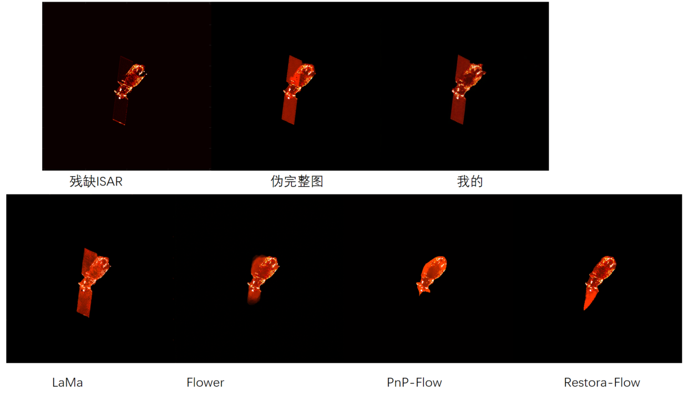
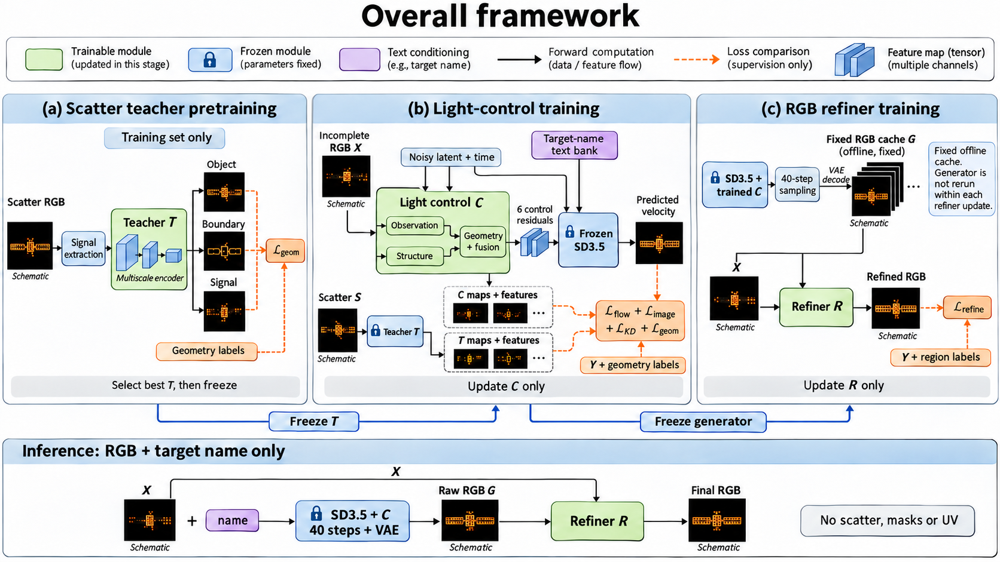
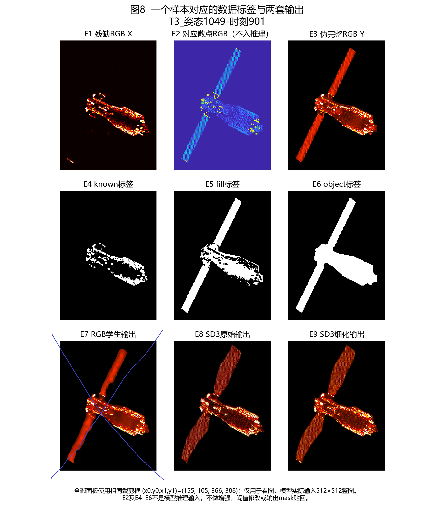

# 周报

把之前的大参数的方法框架删除了很多不相干的部分，现在保留了两套框架。一套预训练SD3.5-medium，batch_size设为1训练十几个小时。一套用一次CNN前向生成补全图，batch_size设为1训练十小时以内。训练参数还没有去统计，应该都不会很大了。

| 方法         |        MAE ↓ |        MSE ↓ |         L2 ↓ | PSNR ↑（dB） |       SSIM ↑ |      DSSIM ↓ |      LPIPS ↓ |     FID ↓ |
| :----------- | -----------: | -----------: | -----------: | -----------: | -----------: | -----------: | -----------: | --------: |
| Flower       |     0.005995 |     0.002070 |     0.001035 |        26.84 |     0.955866 |     0.022067 |     0.064552 |    139.86 |
| Restora-Flow |     0.005233 |     0.002717 |     0.001358 |        25.66 | **0.977156** | **0.011422** |     0.068363 |    158.14 |
| PnP-Flow     |     0.006851 |     0.002730 |     0.001365 |        25.64 |     0.933340 |     0.033330 |     0.078402 |    135.54 |
| LaMa         |     0.004539 |     0.001647 |     0.000824 |        27.83 |     0.975298 |     0.012351 |     0.055899 |     95.28 |
| 我的         | **0.003867** | **0.001452** | **0.000726** |    **28.37** |     0.976165 |     0.011917 | **0.027239** | **47.35** |

分割下游任务

| 方法         |    N |       Dice |       mIoU | 参照来源                       |
| ------------ | ---: | ---------: | ---------: | ------------------------------ |
| 伪完整图     |  409 |        1.0 |        1.0 | 分割模型推理伪完整图得到的mask |
| 残缺ISAR原图 |  409 |     0.5658 |     0.5990 |                                |
| Flower       |  409 |     0.6292 |     0.6491 |                                |
| lama         |  409 |     0.8266 |     0.8031 |                                |
| PnP-Flow     |  409 |     0.4787 |     0.5790 |                                |
| Restora-Flow |  409 |     0.5073 |     0.5897 |                                |
| 我的         |  409 | **0.9126** | **0.8925** |                                |

## 整体框架：三个训练阶段与最终推理

**图1｜整体框架。** 上方(a)(b)(c)依次对应三个训练阶段，下方单独展示最终推理。绿色表示该阶段训练的模块，蓝色锁标表示参数冻结，紫色表示名称文本条件，橙色虚线表示送入损失比较的监督信息。

本方法分为三个依次执行的训练阶段：**①训练小型散点结构教师；②冻结SD3.5、VAE和教师，训练轻量RGB控制适配器；③固定主生成模型，离线生成训练图，再单独训练RGB细化器。** 最终推理只使用残缺RGB和目标名称。

### 三个阶段的衔接

1. **左侧(a)：先从散点学习完整结构。** 散点RGB经过背景校正与归一化形成单通道信号S，小型教师T预测目标、边界与信号。训练标签只用于计算几何损失。完成训练后选择验证best，冻结教师，供下一阶段使用。
2. **中间(b)：把结构知识迁移给只看残缺RGB的控制适配器。** 残缺图X经过观测/结构双路控制网络C，产生六组控制残差，指导冻结SD3.5的速度预测。教师T从散点提取的地图和特征，与C从X提取的对应预测计算几何蒸馏；教师输出只作为loss参考，不进入C或SD3的前向输入。这个阶段只更新C。
3. **右侧(c)：固定生成模型，单独训练细化器。** 将选出的SD3.5＋C固定，对原训练集执行完整40步采样，保存生成图G。细化器R读取X、固定G及两者差异，学习软门控和小残差修正；伪完整图Y与分区标签仍只作训练监督。这个阶段只更新R。
4. **下方推理条：部署时移除训练专用信息。** X与名称经“SD3.5＋C、40步采样、VAE解码”得到G，再用X与G进入R，得到最终RGB。散点、教师、伪完整Y、真实mask和UV均不进入推理。

图中“Freeze T”和“Freeze generator”表示阶段间冻结选出的权重，不是把前一阶段的训练样本或标签传给后一阶段作为推理输入。最终部署仍保留SD3.5和VAE，大主干并未被蒸馏掉。

## 遇到的问题和后续的工作

1.看看有没有完整的ISAR图片作为监督目标，不使用拼接的伪完整图作为监督目标。

2.目前我的方法太简单，没有针对最新的方法创新，需多读论文。后续尝试方向：继续采用我的大框架，然后在具体模块里看能不能针对最新的flow方法进行创新（寻找baseline补全图片存在的问题，针对这种问题进行解决），不去堆卷积块。

3.检查baseline实验有没有跑对，按理说不应该lama（2022）比25，26年的好。

4.裁剪数据集尺寸，尽可能去除黑色背景，然后再重新训练。
